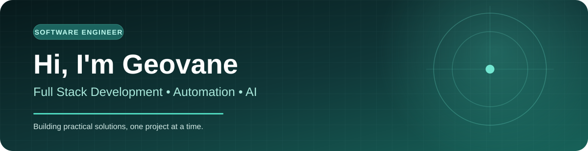

  
    
  
  

 

## About Me

I'm a **Software Engineering student** focused on **Full Stack development**, building projects with **JavaScript, TypeScript, React, Node.js, and Express**.

I enjoy turning what I learn into practical projects and exploring **automation, data, and AI** along the way.

-  Software Engineering student
-  Learning and building Full Stack applications
-  Experience with SQL, data analysis, and automation
-  Exploring AI and its practical applications
-  Working toward a Junior Software Developer role

 

---

## Tech Stack

  

---

## Currently Learning

  
  
  
  
  
  

---

## GitHub

  
  

 

